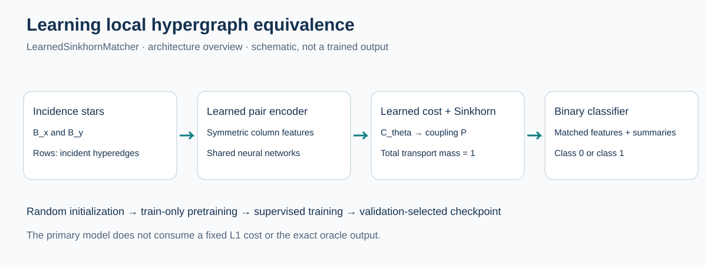

# Hypergraph Equivalence with Learned Sinkhorn Matching

**Mahdieh Sadat Esmaeili**

Learning whether two vertices have the same local pattern of higher-order interactions, even when simple neighbor counts and incidence statistics cannot tell them apart.

[Research paper](docs/paper/Hypergraph_Sinkhorn_Paper_LaTeX_V3.pdf) · [English notebook](notebooks/Phase3_Research.ipynb) · [دفترچهٔ فارسی](notebooks/Phase3_Explained_FA.ipynb) · [Results](results/phase3/aggregate_metrics.csv)

## Research goal

Ordinary graphs describe pairwise connections. Hypergraphs also represent interactions involving a group of vertices at once. Two vertices can have the same neighbors and the same degree while participating in different groups. This project asks whether a neural model can learn to recognize that local structural difference and still work when the structures become larger.

The task is binary classification of **local incidence-star pairs**. Each input is a pair of matrices describing the hyperedges incident to two roots. Each row represents an incident hyperedge; each column represents a shared neighboring vertex. A one records that the neighbor belongs to the incident hyperedge.

| Class | Meaning |
|---|---|
| `1` | Strong structural equivalence: the two matrices have identical multisets of rows, including repeated rows |
| `0` | EE-equivalent candidates whose incident-neighbor row multisets differ |

Positive and negative examples are matched on dimensions, margins, density and total incidence. These simple summaries therefore cannot solve the classification task. The model must compare the patterns of group membership.


*Teal cells indicate membership. In class 1, reordering the rows can align the two local structures. In class 0, the row multisets differ despite the matched summary statistics. Neighbor columns have shared identities.*

## Architecture

The primary model is **`LearnedSinkhornMatcher`**. It learns a cost for each candidate row pair, uses Sinkhorn transport to obtain a soft matching, and classifies the matched representation.



1. **Encode candidate matches.** A shared neural encoder processes symmetric column-pair features and column-degree context.
2. **Learn matching costs.** A neural head produces a nonnegative cost for each pair of incident hyperedges. Fixed L1/Hamming costs and exact Hungarian outputs do not enter the primary model's forward pass.
3. **Compute balanced transport.** Log-domain Sinkhorn iterations produce a coupling with uniform marginals and total mass one.
4. **Classify the pair.** A classifier combines matched features and transport summaries. Averaging directional logits makes the final prediction symmetric under exchanging the two roots.

The model starts from random weights, receives train-only self-supervised cost pretraining and supervised training, and uses validation performance for checkpoint selection.

### Matching and invariance

For valid compact matrices with `m` rows and `k` shared neighbor columns, the classification target is

$$y=\mathbf{1}\!\left[\operatorname{multiset}(B_x)=\operatorname{multiset}(B_y)\right].$$

Balanced transport constrains the coupling:

$$P\geq0,\qquad P\mathbf{1}=\frac1m\mathbf{1},\qquad P^\top\mathbf{1}=\frac1m\mathbf{1},\qquad\sum_{i,j}P_{ij}=1.$$

An ideal hard match therefore assigns mass `1/m` to each matched entry. It does not assign mass one to every match. Predictions should be unchanged by independent row reorderings, a **joint** permutation of shared neighbor columns, or swapping the two roots. Independent column permutations on each side would change the common-neighbor alignment.

## Evaluation

The final synthetic benchmark is `learned_benchmark_v2_final`, evaluated with five seeds: `42`, `100`, `2026`, `777`, `999`.

| Split | Purpose | Samples | Hyperedges m | Neighbors k |
|---|---|---:|---|---|
| Train | Learn model parameters | 800 | 5–12 | 5–10 |
| Validation | Select checkpoints | 800 | 5–12 | 5–10 |
| IID test | New examples from the familiar generation regime | 800 | 5–12 | 5–10 |
| OOD-template test | More structural switches than in training | 800 | 5–12 | 5–10 |
| OOD-size test | Larger local structures than in training | 400 | 15–30 | 12–20 |

Each split is class-balanced. OOD-template uses 5–8 switches, compared with 1–4 in the ordinary regime. See [the locked specification](phase3_spec.json) for the generator settings.

### Primary model results

Values are mean ± sample standard deviation across all five seeds, from the saved [aggregate metrics](results/phase3/aggregate_metrics.csv).

| Test regime | Samples per seed | Accuracy | Balanced accuracy | Macro F1 | ROC-AUC |
|---|---:|---:|---:|---:|---:|
| IID | 800 | 1.000000 ± 0.000000 | 1.000000 ± 0.000000 | 1.000000 ± 0.000000 | 1.000000 ± 0.000000 |
| OOD-template | 800 | 1.000000 ± 0.000000 | 1.000000 ± 0.000000 | 1.000000 ± 0.000000 | 1.000000 ± 0.000000 |
| OOD-size | 400 | 1.000000 ± 0.000000 | 1.000000 ± 0.000000 | 1.000000 ± 0.000000 | 1.000000 ± 0.000000 |

### What the ablations reveal


Removing Sinkhorn barely affects IID accuracy: `LearnedNoSinkhorn` reaches **99.875%**. On larger structures, however, its accuracy falls to **56.85% ± 0.99 percentage points**, and macro F1 falls to **0.469574 ± 0.017862**. The primary model retains perfect classification on this locked OOD-size test.

The no-Sinkhorn model still has OOD-size ROC-AUC **0.998720 ± 0.000906**. Its ranking remains strong even though predictions at the fixed threshold fail. This distinction matters when interpreting the size-shift result: it supports the tested matching formulation without showing that all discriminative information disappears in the ablation.

| Role | Models |
|---|---|
| Primary learned model | `LearnedSinkhornMatcher` |
| Learned baselines | `MLP_Baseline`, `NestedDeepSets`, `BipartiteEncoder` |
| Ablations | `LearnedNoSinkhorn`, `LearnedNoColumnContext` |
| Algorithmic comparators | `DeterministicDifferentiableMatching`, `FixedL1StraightThroughHungarian` |
| Fixed-cost hybrid | `FixedL1ResidualSinkhorn` |
| Exact reference | `ExactHungarianOracle` |

The primary is the best learned model by mean macro F1 across the three final test regimes. Four algorithmic/oracle comparators tie its perfect classification scores; their results are separate from learned-model evidence.

## Evidence and limits

The project includes per-sample predictions, checkpoints, split-integrity checks, negative controls and a saved float64 audit covering **10,000 seed/sample evaluations**. See the [scientific report](results/phase3/final_validation_report.md), [per-seed metrics](results/phase3/per_seed_metrics.csv) and [numerical audit](results/phase3/numerical_audit.json).

Perfect scores apply to these locked **synthetic local incidence-star splits**. They do not establish a universal solver for whole-hypergraph isomorphism or performance on real-world hypergraph datasets. Earlier development test partitions were retired after a disclosed protocol incident; final-v2 tests were locked before their first evaluation, not before all development optimization. The [lock record](results/phase3/learned_benchmark_lock.json) documents this chronology.

## Code and reproducibility

| Directory | Contents |
|---|---|
| `src/` | Models, deterministic data generation, training and audits |
| `configs/` | Model configurations |
| `data/splits/` | Active locked experimental splits |
| `notebooks/` | Final research notebooks in English and Persian |
| `notebooks/early_exploration/` | Early MVP and dataset-generation notebooks, kept for history |
| `results/phase3/` | Active checkpoints, predictions, metrics and scientific evidence |
| `tests/` | Repository tests |

Use Python 3.11 and the pinned dependencies:

```bash
python -m pip install -r requirements.txt
python -m pytest -q
python -m src.final_checks
```

For a full training run, the entry point is `python -m src.run_final_experiments`; it is resumable. Back up existing experimental outputs before running commands that write results. Historical deterministic and development runs are stored separately from the active `results/phase3/` study.

## Theoretical background

The equivalence notions used here follow Marzieh Eidi et al., *Geometric characterisation of structural and regular equivalences in undirected (hyper)graphs*, Journal of Physics: Complexity (2026), [doi:10.1088/2632-072X/ae6f5e](https://doi.org/10.1088/2632-072X/ae6f5e) (open access, CC BY 4.0).
