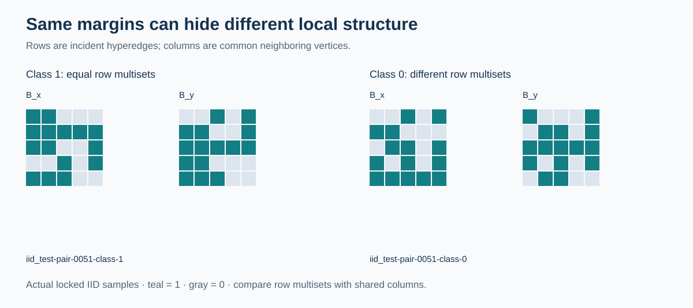
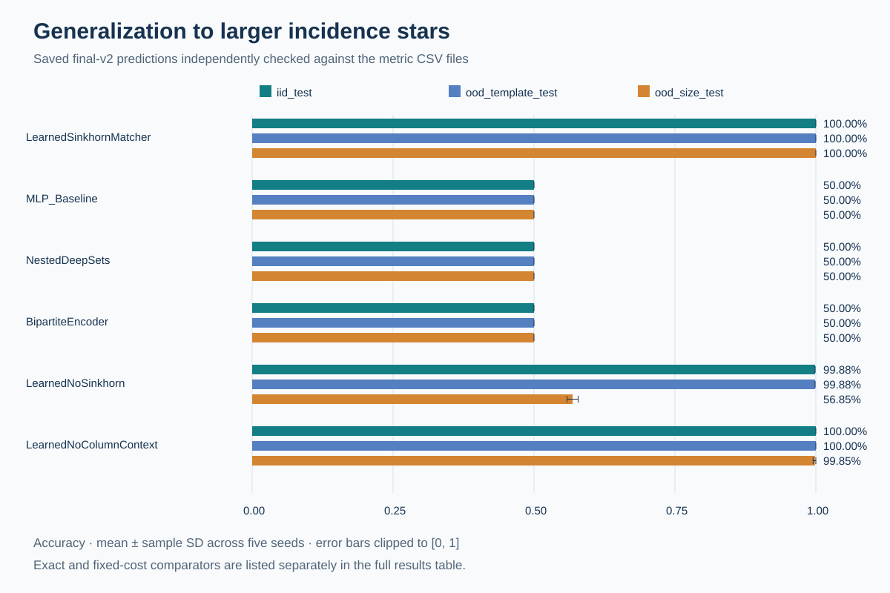

# Hypergraph Equivalence with Learned Sinkhorn Matching

**Mahdieh Sadat Esmaeili**

Learning to distinguish local hypergraph structures that share the same neighbors and incidence statistics, using learned matching costs and normalized optimal transport.

[فارسی](docs/README_FA.md) · [Paper](docs/paper/Hypergraph_Sinkhorn_Paper_LaTeX_V3.pdf) · [Mathematics](docs/MATHEMATICS.md) · [Full results](docs/github/RESULTS.md) · [Reproduce](docs/REPRODUCIBILITY.md)


## What makes this experiment interesting

- **Same summaries, different structure.** Matched positive and negative examples share dimensions, margins, density and total incidence. The task requires comparing the incident-neighbor patterns, rather than counting edges.
- **Learned cost, explicit matching.** `LearnedSinkhornMatcher` starts from random weights. Neither fixed L1/Hamming costs nor exact Hungarian outputs enter its forward pass.
- **Size shift reveals the contribution.** Removing Sinkhorn barely changes IID accuracy, but OOD-size accuracy falls to **56.85% ± 0.99 percentage points** and macro F1 to **0.469574 ± 0.017862**. Its OOD-size ROC-AUC remains **0.998720 ± 0.000906**: this is a thresholded-classification failure with strong ranking retained, not evidence that all discriminative information vanished.
- **Audit beyond accuracy.** The repository includes locked splits, per-sample predictions, checkpoints, five-seed results, negative controls and a saved float64 audit covering 10,000 seed/sample evaluations.

## The task

Each example contains two local incidence matrices. A row is a hyperedge incident to the selected root; a column is a common neighboring vertex. An entry of one records participation of that neighbor in the incident hyperedge. The binary target is:

| Label | Meaning |
|---|---|
| `0` | EE-equivalent local stars that are **not** strongly structurally equivalent |
| `1` | Strongly structurally equivalent local stars: identical multisets of incident-neighbor rows |

This is a synthetic local incidence-star benchmark, not unrestricted whole-hypergraph isomorphism. Row order is arbitrary. Neighbor columns have shared identities: the symmetry is a **joint** column permutation, not independent relabeling on each side.



## Results

Final benchmark: `learned_benchmark_v2_final`. Five seeds: `42`, `100`, `2026`, `777`, `999`. Values below are means over seeds; classification-score SDs for the primary are zero.

| Primary model | Split | Samples per seed | Accuracy | Balanced accuracy | Macro F1 | ROC-AUC |
|---|---|---:|---:|---:|---:|---:|
| `LearnedSinkhornMatcher` | IID | 800 | 1.000000 | 1.000000 | 1.000000 | 1.000000 |
| `LearnedSinkhornMatcher` | OOD-template | 800 | 1.000000 | 1.000000 | 1.000000 | 1.000000 |
| `LearnedSinkhornMatcher` | OOD-size | 400 | 1.000000 | 1.000000 | 1.000000 | 1.000000 |



The primary model is designated by [the specification](phase3_spec.json). It is also the best learned model by mean macro F1 over the three final test regimes. Four fixed-cost/algorithmic/oracle comparators tie its perfect classification scores. Their results are distinct from learned-model evidence.

See [all ten models, all three test regimes, losses and standard deviations](docs/github/RESULTS.md), [per-seed metrics](results/phase3/per_seed_metrics.csv), and [aggregate metrics](results/phase3/aggregate_metrics.csv).

### Model categories

| Category | Models |
|---|---|
| Primary learned model | `LearnedSinkhornMatcher` |
| Learned baselines | `MLP_Baseline`, `NestedDeepSets`, `BipartiteEncoder` |
| Ablations | `LearnedNoSinkhorn`, `LearnedNoColumnContext` |
| Algorithmic comparators | `DeterministicDifferentiableMatching`, `FixedL1StraightThroughHungarian` |
| Fixed-cost hybrid | `FixedL1ResidualSinkhorn` |
| Exact reference oracle | `ExactHungarianOracle` |

## Read the project

| Location | Purpose |
|---|---|
| [Paper](docs/paper/Hypergraph_Sinkhorn_Paper_LaTeX_V3.pdf) | Research manuscript |
| [Research notebook](notebooks/Phase3_Research.ipynb) | Methodology and saved experiment walkthrough |
| [Persian notebook](notebooks/Phase3_Explained_FA.ipynb) | Persian explanation of the same study |
| [Mathematical guide](docs/MATHEMATICS.md) | Target, learned cost, transport mass and symmetries |
| [Reproducibility guide](docs/REPRODUCIBILITY.md) | Environment, verification and rerun commands |
| [`src/`](src/) | Models, deterministic data generation, training and audits |
| [`configs/`](configs/) | Model and selection configurations |
| [`data/splits/`](data/splits/) | Active locked final-v2 splits |
| [`results/phase3/`](results/phase3/) | Active evidence: checkpoints, predictions, metrics, audits and logs |
| [`docs/github/`](docs/github/) | Reproducible presentation assets and independent saved-evidence check |
| [`docs/legacy/`](docs/legacy/) | Historical agent material; not authoritative final results |

The `data/deterministic_benchmark_v2/` and `results/deterministic_benchmark_v2/` directories preserve the separate algorithmic study. The `learned_benchmark_v1_development` directories preserve retired development evidence. Root-level prototype notebooks are historical; use the two notebooks under `notebooks/` for the final study.

## Quick verification

The presentation verifier uses only the Python standard library:

```bash
python tools/build_github_presentation.py --check
```

It checks 250 saved prediction files (180,000 rows), 50 checkpoint hashes, the five-seed metric aggregates, locked split hashes and the historical artifact manifest. It recomputes accuracy, balanced accuracy, macro F1 and ROC-AUC from predictions. [Its recorded result and exact scope](docs/github/presentation_validation.json) are separate from a fresh training run.

For model execution, install the pinned [requirements](requirements.txt) in Python 3.11, then run:

```bash
python -m pytest -q
python -m src.final_checks
```

Full retraining and numerical audits are described in [the reproducibility guide](docs/REPRODUCIBILITY.md); several commands write scientific outputs, so archive existing evidence first.

## Scope and limitations

- Perfect scores describe these locked synthetic splits. They establish neither universal equivalence solving nor performance on empirical hypergraph corpora.
- Checkpoints were selected on validation data. A disclosed v1 development protocol incident led to retirement of those test partitions. The final-v2 tests were locked **before their first evaluation**, not before all development optimization; see [the lock record](results/phase3/learned_benchmark_lock.json).
- Gate B is a small-set fit test and Gate C is a training-fit gate; neither substitutes for separate IID/OOD test evaluation.
- The saved final report records numerical-audit PASS over 10,000 evaluations. The largest saved structural/logit discrepancy is approximately `1.257e-9`; that expensive audit was not rerun for the GitHub presentation update.
- The historical artifact manifest has one pre-existing working-tree difference: `CODEX_PHASE3_STATUS.md`, subsequently extended for a visualization handoff. The presentation verifier reports that difference explicitly; it does not regenerate old evidence to hide it.
- No software license is assigned by this presentation update. Third-party reference material retains its original ownership.

## Research background

The repository includes the reference paper by Eidi et al. on hypergraph equivalence (`10.1088/2632-072X/ae6f5e`). This project studies a learned local matching formulation. Background-paper authorship and project authorship are separate.
