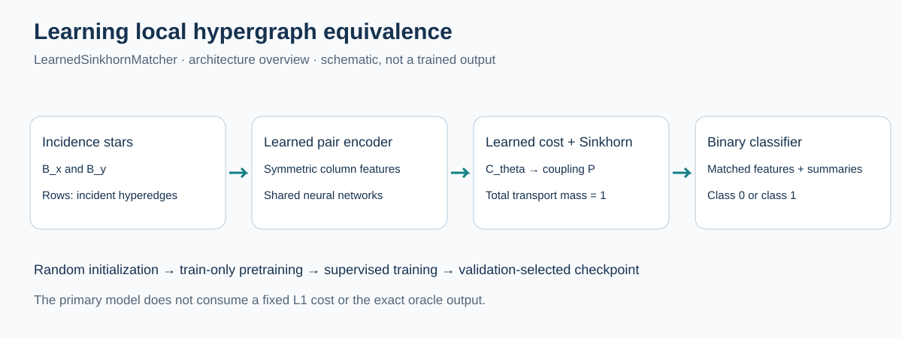
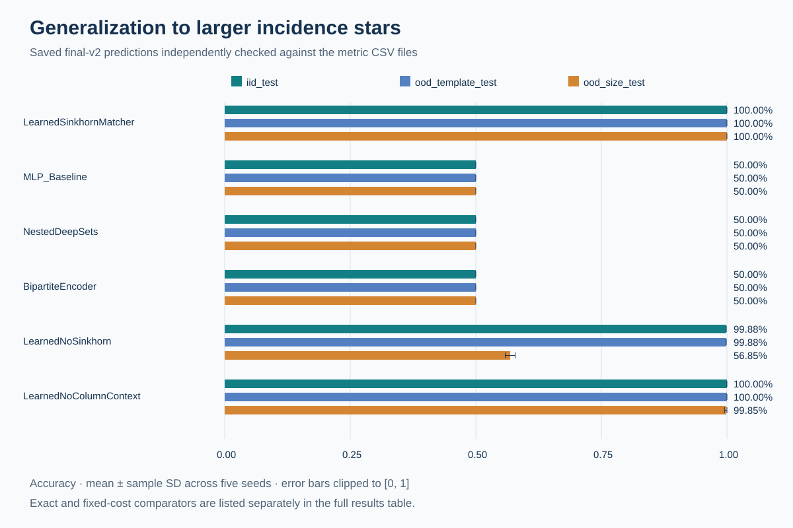

# یادگیری هم‌ارزی محلی در هایپرگراف‌ها

**Mahdieh Sadat Esmaeili**

[معرفی انگلیسی](../README.md) · [مقاله](paper/Hypergraph_Sinkhorn_Paper_LaTeX_V3.pdf) · [فرمول‌ها](MATHEMATICS.md) · [همهٔ نتایج](github/RESULTS.md)

این پروژه یک پرسش مشخص را بررسی می‌کند: آیا دو رأس که همسایه‌ها و آمار ظاهری مشابهی دارند، در رابطه‌های گروهی هم ساختار یکسانی دارند؟ برای پاسخ، الگوی حضور همسایه‌ها در هایپریال‌های متصل به هر رأس با یک مدل یادگیرنده و تطبیق `Sinkhorn` مقایسه می‌شود.

## دسته‌بندی پروژه

این پژوهش در حوزهٔ یادگیری روی ساختارهای گسسته، شبکه‌های عصبی و انتقال بهینه قرار می‌گیرد. مسئله، طبقه‌بندی دودویی هم‌ارزی ساختاری در ستاره‌های وقوع محلی و مصنوعی است. نتیجه را نباید به تشخیص هم‌ریختی همهٔ هایپرگراف‌های ممکن تعمیم داد.

هر سطر ماتریس یک هایپریال متصل به رأس مورد بررسی و هر ستون یک همسایهٔ مشترک است. برچسب `1` یعنی چندمجموعهٔ سطرها یکسان است؛ ترتیب سطرها اهمیت ندارد، ولی تکرارشان مهم است. برچسب `0` برای نمونه‌هایی است که با وجود هم‌ارزی از نوع `EE`، این برابری ساختاری را ندارند. جابه‌جایی ستون‌ها باید در دو طرف مشترک باشد.

## نکتهٔ جذاب پژوهش

مدل اصلی، `LearnedSinkhornMatcher`، هزینهٔ تطبیق را یاد می‌گیرد و سپس از یک ماتریس انتقال با جرم کل `1` استفاده می‌کند. هزینهٔ ثابت `L1` یا پاسخ حل‌کنندهٔ دقیق وارد مسیر پیش‌بینی آن نمی‌شود.

در داده‌های ذخیره‌شدهٔ پنج اجرای مستقل، دقت، دقت متوازن، `Macro F1` و `ROC-AUC` مدل اصلی در هر سه آزمون `IID`، `OOD-template` و `OOD-size` برابر `1` است. تعداد نمونه‌ها در هر اجرا به‌ترتیب `800`، `800` و `400` است. این اعداد به همین مجموعه‌های مصنوعی قفل‌شده مربوط‌اند.

با حذف `Sinkhorn`، دقت آزمون معمولی همچنان حدود `99.875%` است، اما در آزمون اندازه‌های بزرگ‌تر به `56.85%` می‌رسد و `Macro F1` حدود `0.469574` می‌شود. بااین‌حال `ROC-AUC` حدود `0.998720` باقی می‌ماند؛ بنابراین افت تصمیم‌گیری در آستانهٔ ثابت را نباید با از بین رفتن کامل قدرت رتبه‌بندی اشتباه گرفت. جدول کامل، میانگین و انحراف معیار پنج اجرا را جداگانه نشان می‌دهد.

## مسیر پیشنهادی مطالعه

1. [مقاله](paper/Hypergraph_Sinkhorn_Paper_LaTeX_V3.pdf) برای روایت پژوهش و نتیجه‌ها.
2. [راهنمای ریاضی](MATHEMATICS.md) برای تعریف دقیق مسئله و جرم انتقال.
3. [دفترچهٔ فارسی](../notebooks/Phase3_Explained_FA.ipynb) برای توضیح مرحله‌به‌مرحله.
4. [نتایج کامل](github/RESULTS.md) برای مقایسهٔ مدل اصلی، مبناها و حذف مؤلفه‌ها.
5. [راهنمای بازتولید](REPRODUCIBILITY.md) برای اجرای بررسی‌ها.

## اعتبارسنجی این آماده‌سازی

ابزار `tools/build_github_presentation.py` چهار معیار طبقه‌بندی را از `250` فایل پیش‌بینی شامل `180,000` ردیف دوباره محاسبه می‌کند، همهٔ ستون‌های تجمیعی را با مقادیر هر اجرا تطبیق می‌دهد و هش پیش‌بینی‌ها، `50` فایل وزن و داده‌های قفل‌شده را بررسی می‌کند. آموزش دوباره و ممیزی عددی کامل در این مرحله اجرا نشده است؛ نتیجهٔ آن‌ها در شواهد تاریخی پروژه ثبت شده است.

در فهرست هش تاریخی، فایل `CODEX_PHASE3_STATUS.md` به‌دلیل تغییرات قبلی در تحویل خروجی بصری تفاوت دارد. این اختلاف در گزارش بررسی ثبت شده و پنهان نشده است. داده‌های توسعهٔ قدیمی از نتایج نهایی جدا نگه داشته شده‌اند؛ مجموعه‌های آزمون نهایی پیش از نخستین ارزیابی خودشان قفل شده‌اند، نه پیش از تمام فرایند توسعه.
